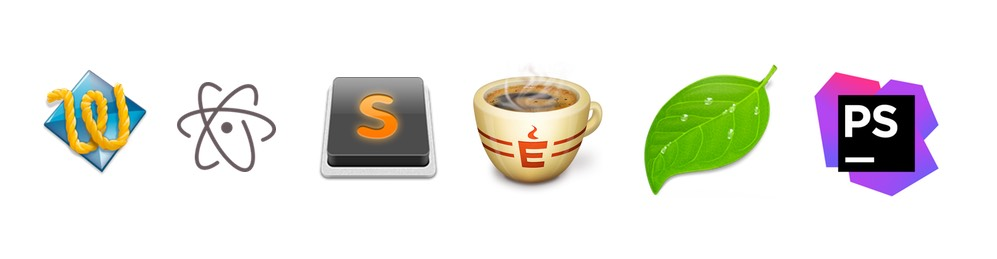
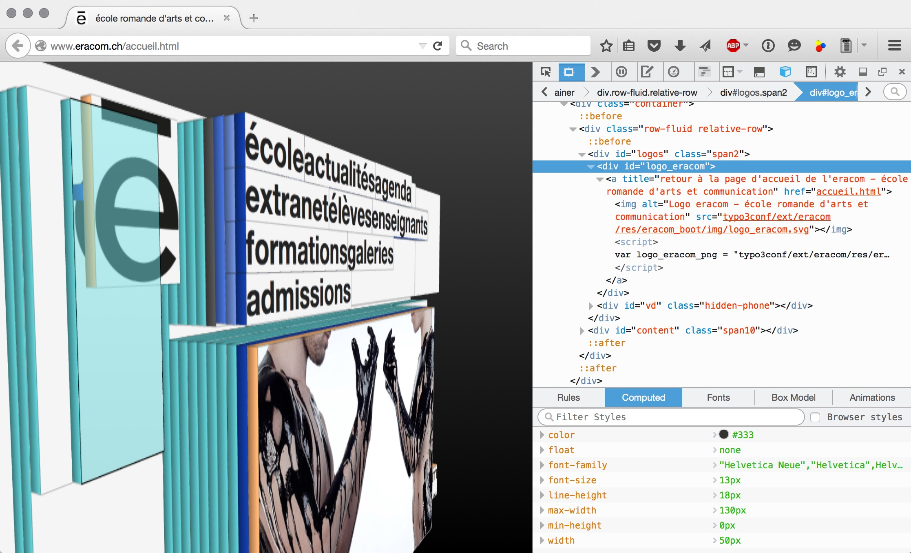

L'éditeur de code est un outil fondamental pour les métiers du web. Il existe un grand nombre d'éditeurs de code, ayant chacun ses particularités. Parmi les fonctionalités partagées par tous les éditeurs de code: 

- la colorisation de la syntaxe, pour faciliter la lecture et la détection d’erreurs.
- la suggestion automatique de termes propres au langage utilisé (HTML, CSS, JavaScript, etc).
- le  « rechercher remplacer » à l'échelle d'un projet ou dossier.
- le « rechercher remplacer » avec des « expressions régulières ».

* *[Visual Studio Code](https://code.visualstudio.com/)* - éditeur de code gratuit produit par Microsoft, disponible pour Windows, Mac et Linux. Inclut le support pour le versionnement Git. Voir [support de cours dédié](https://cours-web.ch/vscode/).
* *[CotEditor](https://coteditor.com/)* - un éditeur simple, gratuit et open-source. Disponible pour MacOS uniquement.
* *[Sublime Text](https://www.sublimetext.com/)* - éditeur freemium. Il existe [un grand nombre d'extensions](https://packagecontrol.io/) pour étendre ses fonctionalités. 
* *[Nova](https://nova.app/)* - successeur de Coda. Prix: $99/an.
* *[PhpStorm](https://www.jetbrains.com/phpstorm/)* par Jetbrains - éditeur spécialisé pour le langage PHP (utile pour le développement de thèmes WordPress, par exemple).

**L'inspecteur du navigateur** est un outil indispensable pour le développement d'interfaces web. Il permet l’analyse des éléments de mise en page d’un site, son chargement, son poids etc. Il est disponible dans les navigateurs majeurs (Firefox, Chrome, Safari). À noter que Firefox propose une "[version développeur](https://www.mozilla.org/fr/firefox/developer/)".

Dans Safari, il est nécessaire d'activer ces outils dans les préférences (sous *Avancées > Afficher le menu Développement...*).

